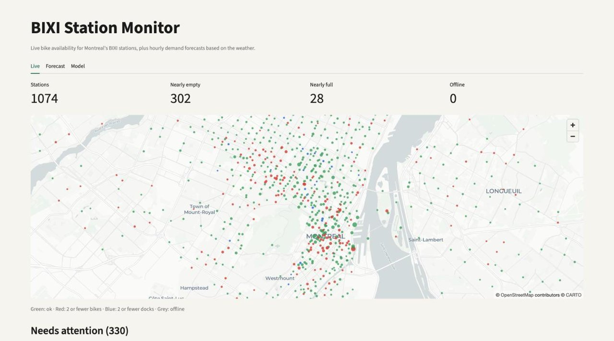
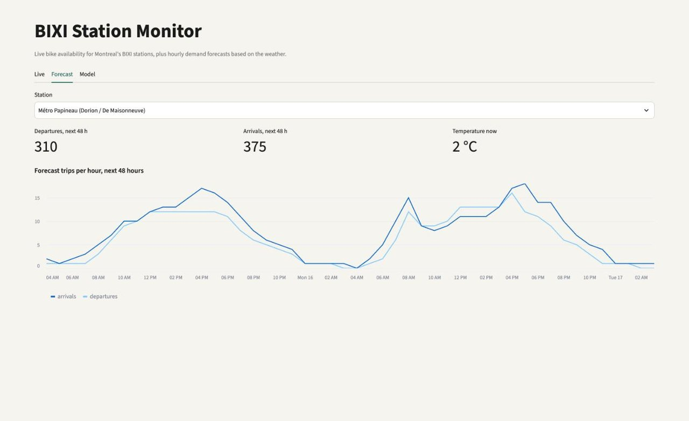
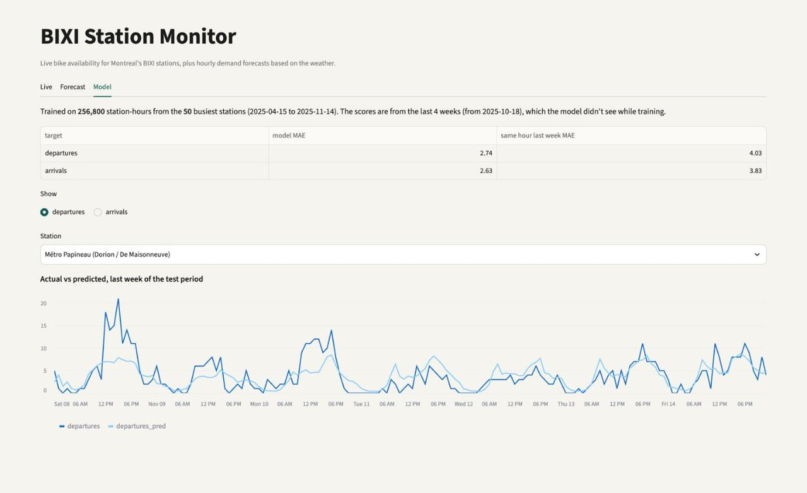
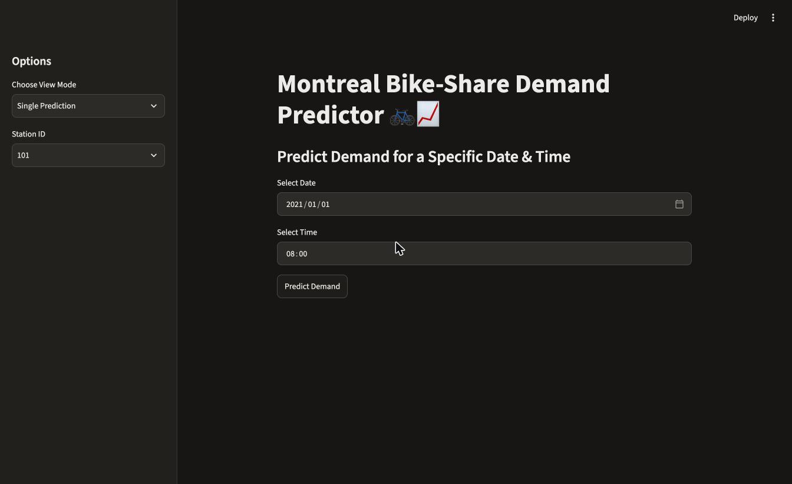

# BIXI Station Monitor

A Streamlit app that shows live bike availability for Montreal's BIXI bike-share stations, and forecasts how many trips each busy station will get per hour based on the weather.



- **Live:** every station from BIXI's public feed on a map, colored by how full it is, plus a list of stations that are nearly empty or nearly full.
- **Forecast:** departures and arrivals for the next 48 hours for a station, using the weather forecast.
- **Model:** how accurate the model is, and actual vs predicted trips for the test period.

| Forecast | Model |
|---|---|
|  |  |

## Results

I trained on real 2025 BIXI trip data: the 50 busiest stations, hourly from April 15 to November 14 (256,800 station-hours), joined with hourly weather. I tested on the last 4 weeks, which the model didn't see during training:

| Target | This model (MAE) | Same hour last week (MAE) |
|---|---:|---:|
| Departures | **2.74** | 4.03 |
| Arrivals | **2.63** | 3.83 |

So the model's average error is about 32% lower than just guessing last week's number. A station gets about 6 trips per hour on average.

## Run it

```bash
pip install -r requirements.txt
streamlit run app.py        # http://localhost:8501
```

Or with Docker:

```bash
docker build -t bixi-monitor .
docker run -p 8501:8501 bixi-monitor
```

The trained model and the dataset are in the repo, so the app works right after cloning.

## Rebuild the data and retrain

```bash
# 1. Download the 2025 trip file from https://bixi.com/en/open-data
# 2. Count trips per station per hour and add the weather
python scripts/build_dataset.py path/to/DonneesOuvertes2025_....zip
# 3. Train and test the model
python -m src.train
```

## Tests

```bash
python -m pytest
```

8 tests that don't need the internet: the features, the train/test split, the baseline, training and predicting, and reading the BIXI and weather data (using saved sample responses). GitHub Actions runs them on every push.

## Project structure

```
app.py                     the Streamlit app
src/features.py            builds the model inputs (used by training, prediction and the app)
src/data.py                loads the dataset, gets weather from Open-Meteo
src/live.py                gets live station data from BIXI
src/train.py               train/test split, baseline, training
src/predict.py             loads the model and makes forecasts
scripts/build_dataset.py   raw BIXI trips -> data/hourly_demand.csv.gz
models/                    saved model and results
```

## Data sources

- Trips: [BIXI open data](https://bixi.com/en/open-data)
- Live availability: [BIXI GBFS feed](https://gbfs.velobixi.com/gbfs/gbfs.json)
- Weather: [Open-Meteo](https://open-meteo.com/)

## First version

The first version was a single prediction form trained on a small made-up CSV:



This version uses real trip data, tests the model properly on later dates, and adds live availability.
